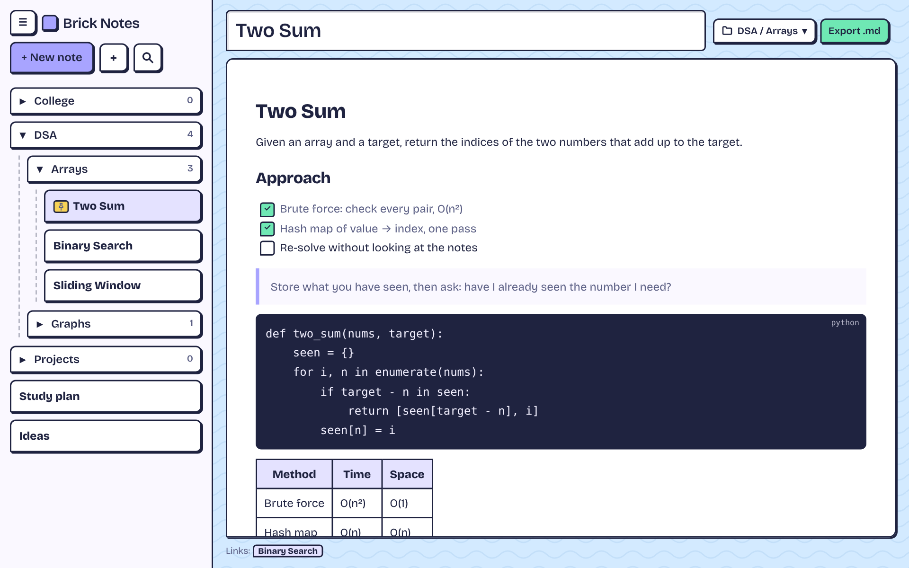
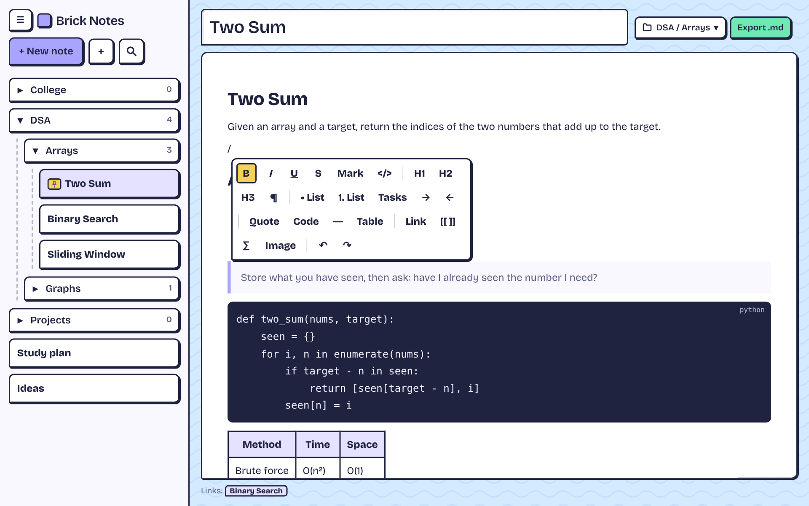
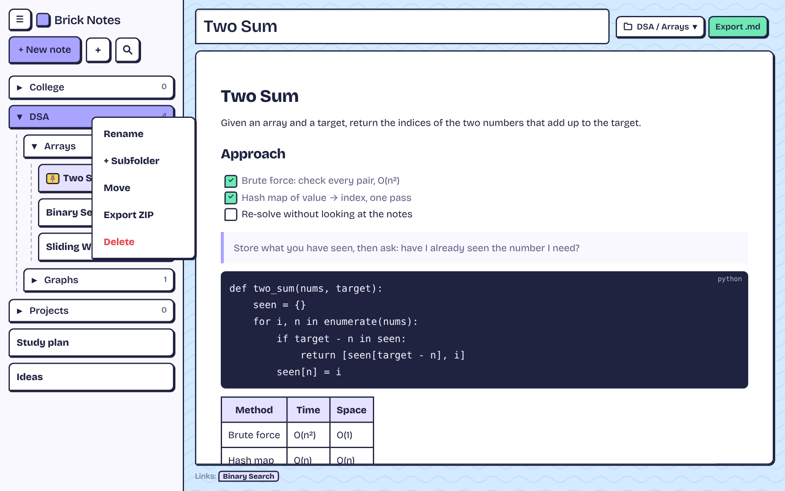
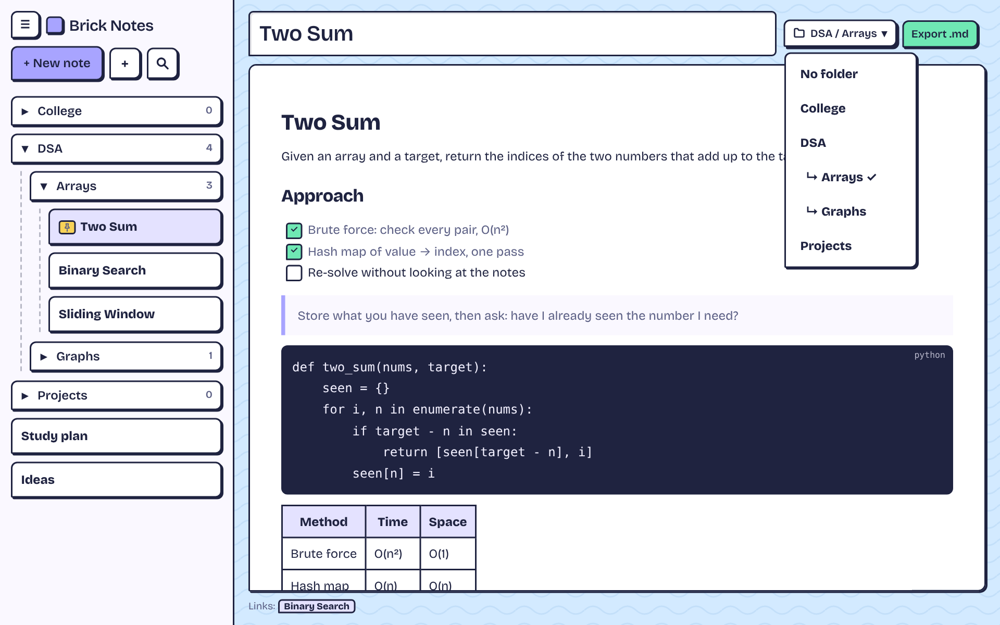
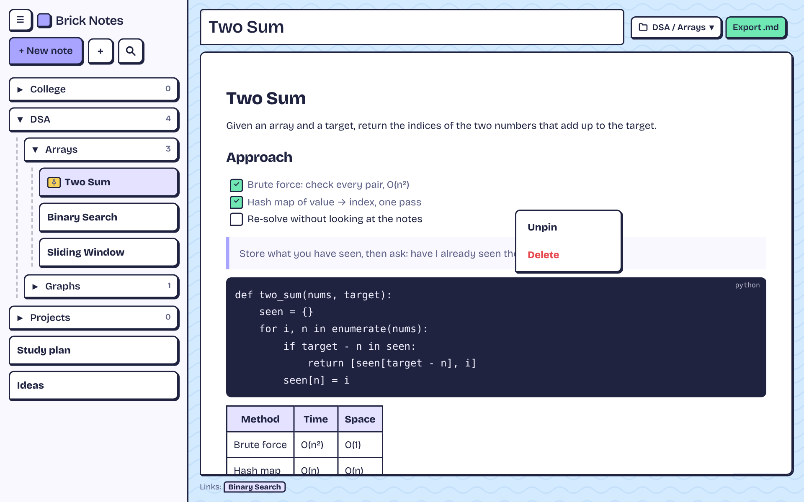
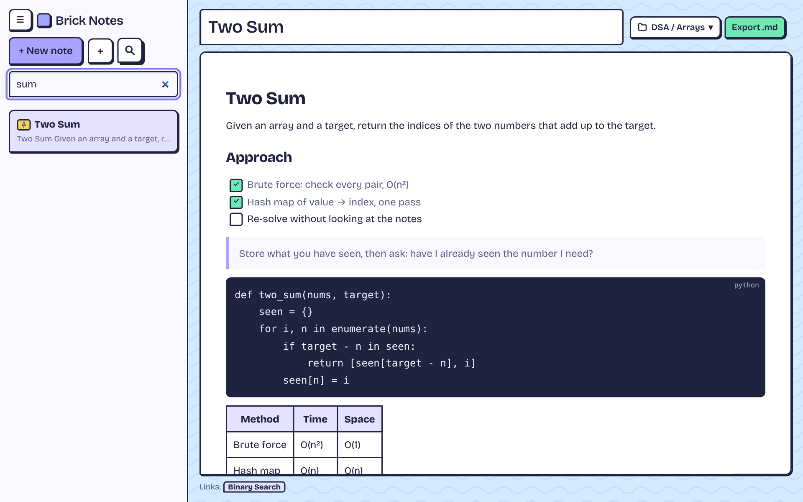
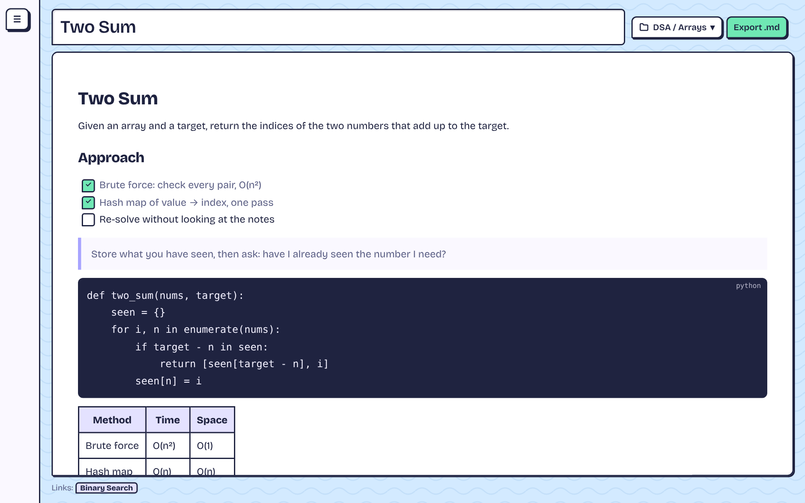
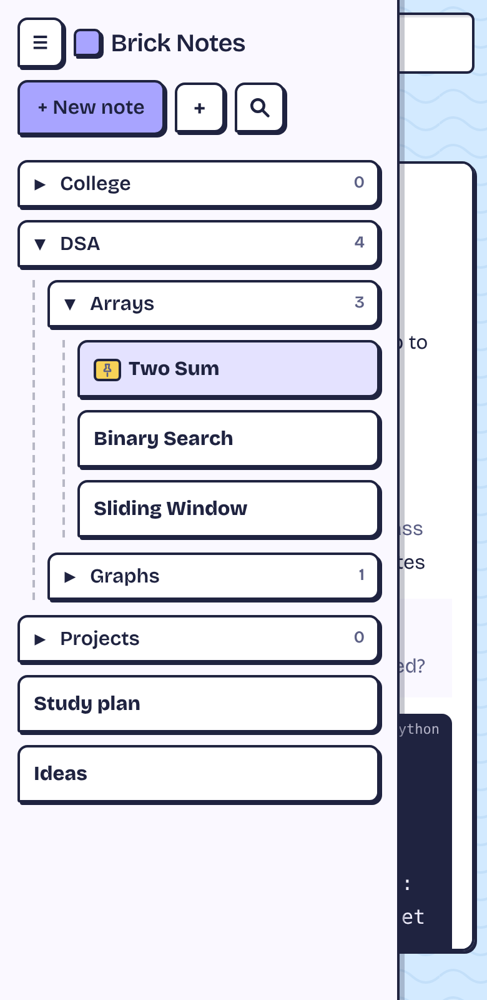
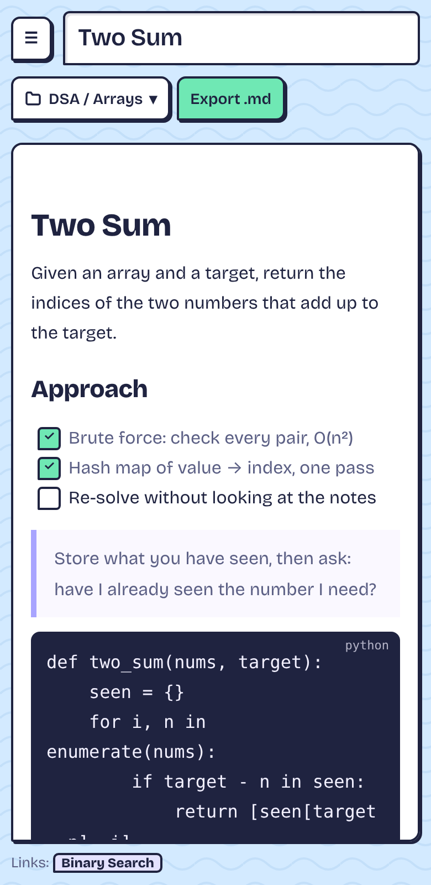

# Brick Notes

A fast, private note-taking app that lives in a **single HTML file**. No install, no build step, no account, no server. Open `index.html` and start writing.

Notes are organised in a nested folder tree you can drag and drop, written in a clean block editor with a Notion-style `/` command menu, and can be exported as Markdown.



## Features

- **Nested folders as a tree.** Folders contain notes and other folders, as deep as you like. Each folder has an arrow to expand or collapse it.
- **Drag and drop.** Drag a note into a folder, drag a folder into another folder, or drop on empty space to move something back to the top level.
- **Right-click menus.** Right-click a folder for Rename, Subfolder, Move, Export ZIP and Delete. Right-click a note, or the page itself, for Pin and Delete.
- **`/` command menu.** Type `/` anywhere in a note and the formatting block pops up next to your cursor. Keep typing to filter it.
- **Rich block editor.** Headings, bold, italic, underline, strikethrough, highlight, inline code, code blocks, quotes, bullet and numbered lists, checklists, tables, dividers, web links and images.
- **Equations.** Type `$E=mc^2$` for an inline equation, or use the equation dialog for block equations. Rendered with KaTeX.
- **Note links.** Type `[[Note title]]` to link to another note. Click the link to jump there. A link to a note that does not exist offers to create it.
- **Search.** `Ctrl/Cmd + K` opens search across titles, content and tags.
- **Pinned notes** stay at the top of their folder.
- **Markdown export.** Export a single note as `.md`, or export a whole folder (with its subfolders) as a ZIP that keeps the folder structure and rewrites note links to relative paths.
- **Autosave.** Everything is saved as you type. There is no save button and no status text, only a warning if saving ever fails.
- **Works on desktop and phone.** The sidebar collapses on desktop and slides away on small screens.

## Screenshots

### Slash menu

Type `/` and the formatting block appears at the cursor. Type to filter (`/head` shows H1, H2 and H3), use the arrow keys and Enter, or click.



### Folder tree and right-click menu

Click a folder's name or arrow to open and close it. Right-click a folder for its options.



### Moving a note to a folder

The folder button beside the note title shows where the note lives (for example `DSA / Arrays`) and opens a nested picker.



### Right-click the page

Pin or delete the open note from the page's own right-click menu. Hold **Shift** while right-clicking to get your browser's normal menu back (spell-check, copy and paste).



### Search



### Collapsible sidebar

The ☰ button inside the sidebar shrinks it to a thin rail so the note gets the full screen width. Click it again to bring the sidebar back.



### On a phone

| Sidebar | Editor |
| --- | --- |
|  |  |

## Getting started

1. Download or clone this repository.
2. Open `index.html` in any modern browser (Chrome, Edge, Firefox, Safari).

That is the whole setup. You can also serve the folder with any static host, for example GitHub Pages: push the repo, then enable Pages for the main branch and the root folder.

> **Internet access:** the page loads three things from a CDN: the Bricolage Grotesque font (Google Fonts), KaTeX for equations, and JSZip for ZIP export. Without a connection the app still works, but it falls back to a system font, equations will not render, and ZIP export will not work.

## Using the app

### Notes

- **New note:** click **+ New note** or press `Alt + N`. If a folder is selected, the note is created inside it.
- **Rename:** edit the title field at the top of the note.
- **Pin / delete:** right-click the note in the sidebar or right-click the page.
- **Change folder:** use the folder button next to the title.
- **Export:** the **Export .md** button next to the title downloads the note as Markdown with a small front-matter block (title, tags, created, modified).

### Folders

| Action | How |
| --- | --- |
| Create a top-level folder | Click **+** next to the search button |
| Create a subfolder | Right-click a folder, then **+ Subfolder** |
| Open or close a folder | Click its name or its arrow |
| Rename, move, export, delete | Right-click the folder |
| Move a note or folder | Drag it onto another folder |
| Move something to the top level | Drop it on empty space in the list, or use **Move** and pick **Top level** |

Clicking a folder's name opens it and selects it, so new notes are created inside. Closing it deselects it, so new notes go back to the top level.

Deleting a folder does **not** delete its contents: its notes and subfolders move up one level. A folder cannot be moved into itself or into one of its own subfolders.

On touch screens, long-press a folder or a note to open its menu, since touch has no right-click.

### Writing

Type `/` to open the command menu. These Markdown-style shortcuts also work at the start of a line:

| Type | Result |
| --- | --- |
| `# ` , `## ` , `### ` | Heading 1, 2, 3 |
| `- ` or `* ` | Bullet list |
| `1. ` | Numbered list |
| `[] ` | Checklist |
| `> ` | Quote |
| `$...$` | Inline equation |
| `[[Title]]` | Link to another note |

Other editor details:

- **Checklists:** click the box at the left of an item to tick it.
- **Tables:** use `Tab` and `Shift + Tab` to move between cells.
- **Lists:** `Tab` and `Shift + Tab` indent and outdent.
- **Images:** choose **Image** in the `/` menu. Images are embedded in the note, so each one must be **700 KB or smaller**.
- **Equations:** click an existing equation to edit it.
- **Links:** `Ctrl/Cmd + click` opens a web link in a new tab.

### Keyboard shortcuts

| Shortcut | Action |
| --- | --- |
| `Alt + N` | New note |
| `Ctrl/Cmd + K` | Search |
| `Ctrl/Cmd + S` | Save now |
| `Ctrl/Cmd + B / I / U` | Bold, italic, underline |
| `Ctrl/Cmd + Shift + X` | Strikethrough |
| `/` | Open the command menu |
| `↑` `↓` `Enter` `Esc` | Navigate, pick, or close the `/` menu and right-click menus |

## Your data

- Notes are stored in your browser's **localStorage** under the key `bricknotes:v1`. Nothing is sent anywhere. There is no server and no tracking.
- Data belongs to **one browser on one device**. It does not sync between devices or between browsers.
- Clearing site data or browsing history for the page **deletes your notes**. Opening the file from a different location (a different `file://` path or a different web address) shows a different, empty set of notes.
- There is no built-in backup or import. Use **Export .md** for single notes and **Export ZIP** (right-click a folder) to keep copies outside the browser.

## Project structure

```
brick-notes/
├── index.html      The entire app: HTML, CSS and JavaScript in one file
├── README.md       This file
└── screenshots/    Images used in this README
```

## Tech

- Plain HTML, CSS and JavaScript. No framework, no bundler, no dependencies to install.
- The editor is a `contenteditable` surface with sanitised paste handling.
- [KaTeX](https://katex.org/) for equations and [JSZip](https://stuk.github.io/jszip/) for folder export, both loaded from cdnjs.
- [Bricolage Grotesque](https://fonts.google.com/specimen/Bricolage+Grotesque) from Google Fonts.

## Known limitations

- No sync, accounts, sharing, or collaboration.
- No import and no one-click full backup.
- Images are stored inside the note, so many large images can fill the browser's storage quota (usually a few megabytes). If saving fails, the app shows a warning.
- Drag and drop uses the browser's native drag events, which work with a mouse. On touch screens use the **Move** option in a folder's menu, or the folder button beside a note's title.

## License

No license has been chosen yet. Add a `LICENSE` file (for example MIT) before sharing the project publicly.
